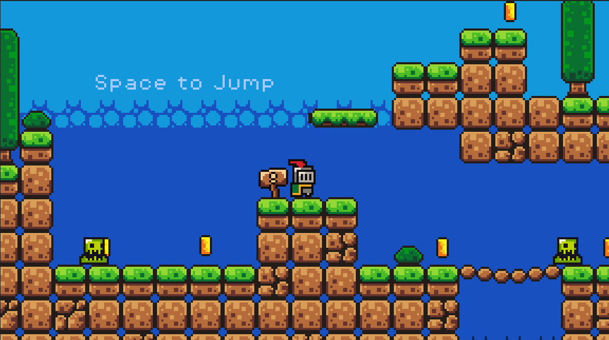
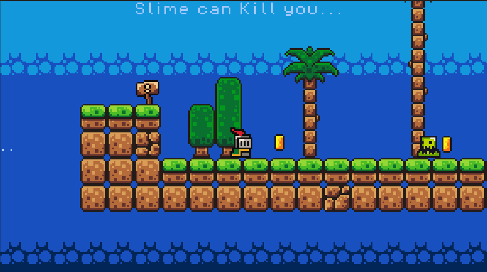
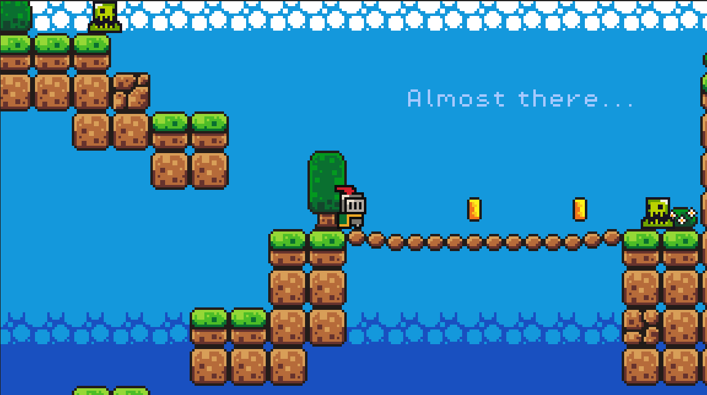
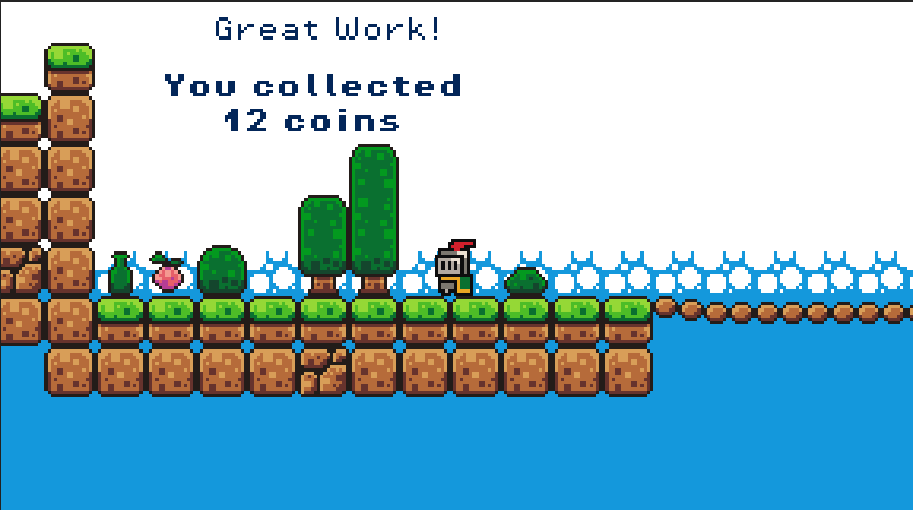

# godot-knight-adventure

A 2D adventure game built using Godot Engine and GDScript.


## Getting Started

Follow these steps to run the project locally.

### Prerequisites
- Godot Engine installed on your computer.
- Git installed on your system.

### Installation
- Clone the repository:
```bash
git clone https://github.com/manishdait/godot-knight-adventure.git
```
- Navigate to the project directory:
```bash
cd godot-knight-adventure
```
- Open Godot Engine.
Click Import and select the project.godot file from the project directory.
Open the project and press F6 or F5 to run the game.

## Controls

| Action | Key |
| :--- | :--- |
| Move Right | `Left Right` / `A` |
| Move Left | `Left Arrow` / `D` |
| Jump | `Space` / `Up Arrow` |

## Screenshots




